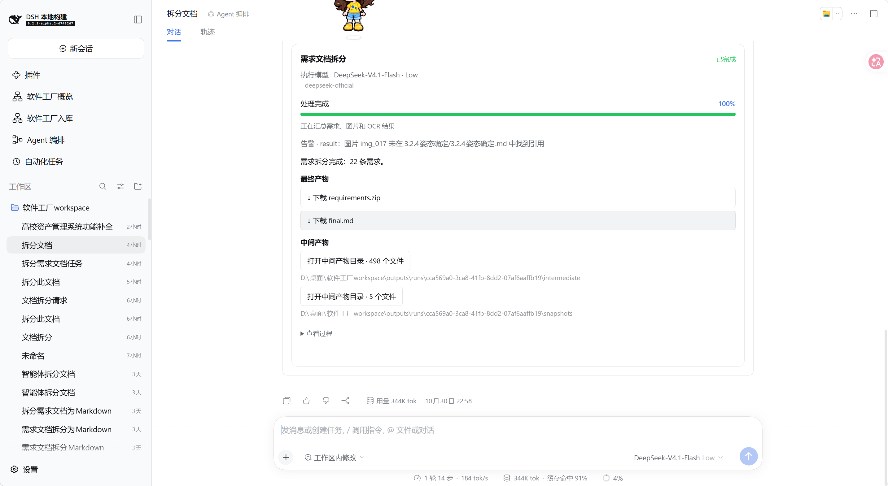

# 软件工厂 Run（Runtime）

运行在 DeepSeek Harness（DSH）中的软件工厂后端插件，负责调用业务 Tool，统一管理任务状态、阶段、进度、日志、错误、取消和交付产物。可以直接使用，也可以由 Agent 编排插件调用。

**普通用户请使用 [Releases](https://github.com/Waller-Man/software-factory-runtime/releases) 中的预编译安装包，按下面的快速启动步骤安装。GitHub 的源码下载 ZIP 不等于插件安装包。** 本项目依附 DSH 运行，没有独立网页、独立启动服务或自己的数据库连接配置。

## 功能

- **统一执行入口**：调用通过 Run SDK 登记的业务 Tool，每次调用创建独立 runId；启动后快速返回任务标识，供后续查询。
- **执行过程记录**：接收下层上报的状态、当前阶段、百分比、消息和日志，供上层与聊天执行卡查看。
- **错误与告警**：保存问题所在阶段、原因和时间；任务失败、取消或中断后，保留已产生的材料。
- **文本与文件交付**：保存最终文本、最终文件及中间材料索引，提供需要 DSH 认证的下载地址和中间产物目录引用。
- **模型调用**：复用 DSH 的模型配置和凭据，支持文本、图片以及开发者显式传入的多轮历史；模型请求使用隔离会话记录。
- **取消与历史查询**：向业务代码、模型请求和清理回调传递取消信号，支持查询历史任务。不提供暂停／恢复功能。

Run 负责管理执行，业务插件负责实际算法，SDK 帮助业务插件接入统一协议。Agent 选择和多步编排由调用方负责；直接指定业务 Tool 和参数即可启动 Run，不要求先经过编排 Agent。

## 运行截图

以下是用户提供的实际运行截图，展示配套 WebUI 在 DSH 聊天区呈现 Runtime 任务的效果：执行模型、完成状态、百分比、业务告警、最终文件下载及中间材料目录。本包只提供后端，图中的执行卡由 WebUI 渲染。

### 需求文档拆分执行结果（截图一）


### 聊天执行卡与产物入口（截图二）



## 环境与配套插件

当前包版本为 **0.1.0**，开发目标为 **DSH 0.2.1-alpha.2、Node.js 24 或以上**，Cordis peer 版本为 `4.0.5-alpha.1`。其他 DSH 版本需另外核对兼容性。

| 使用场景 | 需要准备的环境或服务 |
| --- | --- |
| 加载 Runtime | 兼容的 DSH 及其 tools、agents、typert 等原生服务 |
| 执行业务算法 | 已启用、通过 Run SDK 登记且当前会话可见的业务插件；使用真实 DSH 工作区 |
| 在算法内调用模型 | DSH 模型服务及有效的 provider/model 配置；纯算法可以不配置模型 |
| 在模型请求中使用图片 | 宿主附件服务，以及实际声明 image 能力的模型路由 |
| 显示聊天执行卡 | 按需安装配套 WebUI，并按其说明准备所需依赖 |
| 由 Agent 组织多步任务 | 按需安装 Orchestration 及其配套服务 |

**Runtime 不需要 HugeGraph、Gateway 或 Manage 才能执行任务，也不需要单独填写 `.env` 或模型 API Key。** 使用完整软件工厂界面时，各模块需要的数据库与依赖按照各自文档准备。Python、OCR 等业务依赖由对应业务插件负责，在部署阶段预先安装。

Run SDK 是开发者项目里的接入依赖，不是需要在 DSH 插件列表中另行启用的服务。Runtime 安装包内带有 SDK 文件以保证分发完整性；业务开发仍通过公开的 `@software-factory/runtime-sdk` 接入。

## 新电脑快速启动：使用预编译包

### 1. 准备宿主和业务插件

1. 安装并启动兼容版本的 DSH，确认原生网页可以正常登录，且有“插件”管理入口。
2. 准备一个工作区目录，在 DSH 中选择该真实工作区并创建会话。任务输入和产物会保存在这里。
3. 准备需要执行的业务插件安装包及其运行环境。Runtime 本身不包含需求补全、文档拆分或报告生成算法。
4. 如业务需要模型，先在 DSH 原生设置中完成模型配置。Runtime 的 model 参数可选，纯算法不必使用模型。

本 README 从 DSH 已正常运行开始说明；宿主安装及启动命令以对应 DSH 发行版说明为准。Runtime 由 DSH 加载，没有独立的 `npm start`。

### 2. 下载并解压 Runtime

从本仓库的 **Releases／发布** 下载 `software-factory-runtime-0.1.0.zip`，解压到一个长期保留的目录，例如：

```text
D:\DSH-Plugins\software-factory-runtime\
├── package.json
├── cordis.patch.yml
├── README.md
├── THIRD_PARTY_NOTICES.md
├── icon.svg
├── lib\
├── docs\
└── locale\
```

以**包含 `package.json` 的目录**为准；解压后如果多了一层文件夹，继续进入内层。使用预编译包不需要手动安装源码开发依赖或执行构建；DSH 安装器仍可能解析包依赖，因此不承诺完全离线安装。

尚未发布 Release 时，请联系维护者获取预编译 ZIP 或完整运行目录。也提供同版本 TGZ，按宿主支持的包安装方式使用；普通用户优先选择 ZIP 解压后的目录。

### 3. 在 DSH 网页安装

1. 打开“插件 → 添加插件 → 安装第三方插件”。
2. 安装来源填写上述目录的绝对路径，例如 `D:\DSH-Plugins\software-factory-runtime`。这是 **DSH 服务端电脑**上的路径；远程访问时不能用浏览器电脑上的路径代替。
3. 安装完成后启用组合包及 `sf-runtime` 插件条目，包名为 `@software-factory/runtime`；确认没有激活错误。需要重启时按宿主提示操作。
4. 再安装并启用使用 Run SDK 的业务插件。入口会自动登记，停用业务插件时自动撤销，不需要配置 Tool 白名单。

本地目录安装需要保留安装目录，不要安装后删除、移动或改名。不要重复启用已经包含同一 Runtime 的组合包。

如需聊天小卡片，另行安装并启用 `@software-factory/webui`。Runtime 本身不增加侧栏页面；没有 WebUI 仍可使用 Tool／Remote 查询和取消任务。

### 4. 验证可用

在真实工作区会话中，先让模型调用 `sf_runtime_get_tool_contract`，传入实际已安装业务工具的 toolId，确认能够取得真实输入规格。再调用 `sf_runtime_run_tool`，例如：

```json
{
  "toolId": "替换为实际已安装的业务Tool名称",
  "input": { "text": "需要处理的业务材料" }
}
```

这里的 text 只是输入示例，以业务 Tool 的真实 inputSchema 为准。成功返回中会包含 `runId` 和 `status: "queued"`；随后用 `sf_runtime_get_run` 查询该 runId，或用 `sf_runtime_wait_run` 有界等待新进度。

- **执行过程**：能够看到业务上报的阶段、百分比和消息。未上报的内容不会自动补造。
- **完成与错误**：完成后能取得最终文本和文件；失败时能看到对应阶段与原因。
- **文件交付**：使用 WebUI 的最终产物下载按钮，或通过 `sf_runtime_get_artifact` 获取文件下载引用。中间材料通过目录入口查看，打开能力取决于宿主部署方式和权限。
- **取消**：调用 `sf_runtime_cancel_run`，检查业务是否响应取消并保留已生成材料。

验证安装可以先使用轻量业务工具，无需默认运行耗时算法。**插件启用成功不等于模型、业务算法或文件下载已经验证。**

## 模型与执行配置

模型省略时，Runtime 保存发起会话已有的模型；没有模型仍可执行纯算法。显式指定时，在启动请求顶层传入 `model: {provider, model, reasoningEffort?}`，使用 DSH 原生目录中的真实 ID。模型与工作区在任务启动时固定，不随主聊天后续切换而改变。

业务通过 `execution.model.call({messages})` 调用模型。图片支持公网 HTTP(S) 地址或 PNG／JPEG／GIF／WebP 的 Base64 Data URL；普通文档先由业务代码解析为文本或图片。多轮历史由业务代码显式传入，不自动维护上下文。详见[接口规范](docs/runtime-api.md)。

超时通常保留默认值即可。如有需要，在 DSH 原生插件配置界面设置，单位为毫秒：

```yaml
defaultTimeoutMs: 1800000
modelTimeoutMs: 120000
```

## 产物保存在哪里

产物保存在**发起任务的真实工作区**，不在 Runtime 插件安装目录：

```text
<工作区>/outputs/runs/<runId>/
├── run.json             状态、日志、错误告警、事件和结果
├── input/request.json   自动保存的调用参数，无须用户填写
├── intermediate/        中间材料
├── snapshots/           业务按需保存的逐轮快照
├── final/               最终文件
└── logs/                隔离模型会话等执行记录
```

| 结果字段 | 含义 |
| --- | --- |
| result.text | 最终交付文本 |
| result.files | 最终交付文件的完整信息数组 |
| artifacts | 全部已登记文件，kind 区分 intermediate 与 final |
| intermediateDirectories | 中间材料目录与登记文件数 |
| status／issues／logs | 任务状态、错误告警和过程日志 |

单个文件包含 artifactId、kind、name、relativePath、mime、size，以及按接口取得的认证 downloadUrl；没有每个文件独立的 status 字段。业务函数返回的是已登记 final 文件的 ID，Run 查询结果中的 result.files 则是完整文件信息。

失败、取消、中断也保留已产生材料；查询这些任务时不要只检查 result.files。下载需要 DSH 登录和工作区授权，不能把地址当作匿名公开链接分享。

## 更新与停用

- **更新**：按发布说明通过 DSH 正常流程更新安装包，重启 DSH；使用 WebUI 时再刷新网页。需要时同步更新 SDK、业务插件或 WebUI。
- **停用／启用**：在 DSH“插件”页操作，重新启用后确认业务入口恢复。停用不会删除真实工作区中的历史产物。
- **正在执行的任务**：需要终止业务时先通过取消接口操作，检查状态后再维护插件。业务代码和子进程应响应取消；不能强制安全中断任意同进程算法。
- **历史任务**：重启后读取未结束的历史记录会标记 interrupted，不自动重跑，也不提供断点恢复。
- **保留目录**：保留安装目录及工作区的 outputs/runs，不要用清理安装文件的方式删除历史成果。

## 遇到问题

- **缺少 lib/index.js**：可能误用了 GitHub 源码 ZIP；改用 Releases 中的预编译包，并选择包含 package.json 的目录。
- **插件未就绪或看不到 Tool**：检查 DSH 版本、原生依赖、组合包及 sf-runtime 是否启用，确认当前会话的工具权限。
- **PROTOCOL_UNSUPPORTED**：检查业务插件是否通过 SDK 登记、已启用且当前会话可见；业务插件停用后不能继续调用旧入口。
- **WORKSPACE_REQUIRED**：从已经选择真实工作区的 DSH 会话发起，不能在请求里自行伪造输出目录。
- **MODEL_REQUIRED／MODEL_IMAGE_UNSUPPORTED**：检查模型是否配置、实际路由是否支持图片；图片还需要宿主附件服务。
- **没有聊天卡片**：本包只有后端，检查 WebUI 是否安装启用；隔离会话执行时，编排插件还需传入真实所属会话。
- **取消后仍显示取消中**：业务代码或子进程可能尚未响应信号；检查日志和清理结果，不代表已经停止。
- **登录、下载或目录打开失败**：重新登录 DSH，检查 Runtime 状态、工作区权限及宿主部署方式；向维护者提供具体错误，避免附带凭据和敏感原始输入。

## 待解决问题

### 内部模型会话未命名、未归入工作区分组

**状态：待解决，尚未修改实现。记录日期：2026-10-31。**

- **现象与影响**：内部模型调用可能在 DSH 侧栏留下多条“未命名”会话，并堆积在“未分组”，难以判断所属任务，干扰正常聊天列表。
- **已确认的代码原因**：Runtime 每次调用模型都会创建独立的 `sf-run-model-*` 会话；宿主持久化服务可用时，会把记录写入 DSH。当前没有设置可读标题，也没有登记工作区分组归属。仅设置工作目录 `cwd` 不等于加入侧栏工作区；结束时关闭持久化句柄也不会删除会话记录。
- **待处理内容**：为插件创建的内部会话设置明确名称，关联所属 Run／来源会话，并按宿主机制归入来源工作区或明确的内部会话分组，避免散落在“未分组”。任务产物仍保存在发起任务的真实工作区，不移到插件安装目录。
- **核实范围**：已确认这段实现会产生上述现象，但尚未逐条核对用户侧栏中的会话 ID，不能把所有未命名会话都认定为 Runtime 创建。历史会话的归属与整理方式仍需后续核实。

## 开发与发布说明

源码可以作为独立 Git 子仓库管理，但**当前仍需放在 reconstruct 工作区中构建**：依赖相邻的 contracts、runtime-sdk、gateway 构建脚本、共享接口文档，以及已准备开发依赖的兼容 DSH 源码。单独克隆 runtime 并执行 npm install 不能补齐这些文件。

在准备完整的 reconstruct 根目录使用 `npm.cmd run build:runtime` 和 `npm.cmd run pack:runtime`；按需执行 `npm.cmd run check:runtime`、`npm.cmd run test:runtime`。DSH 源码不在默认相邻位置时，通过 DSH_SOURCE 指定其路径。

本地安装包输出到 `artifacts/`，解压运行目录在 `artifacts/release/software-factory-runtime/`。**源码提交 Git；Runtime 和 SDK 的 ZIP／TGZ 上传远程仓库 Releases 附件**，不提交到源码的 packages 目录。当前 Runtime 清单带 private: true，尚未配置 npm／Packages 服务发布。源码仓库中的 lib、artifacts、依赖、缓存和本机凭据由 .gitignore 排除。

完整的7项 Tool、8项 Remote、SDK接口及返回字段见[接口规范](docs/runtime-api.md)。第三方接入请同时取得 SDK 交付包及其 README。打包依赖的许可证见[第三方说明](THIRD_PARTY_NOTICES.md)。已有隔离测试使用模拟模型和 HTTP 响应；实际电脑、用户 profile、真实模型与下载需要部署后检查。
