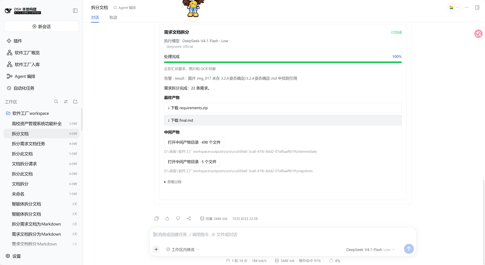

# 软件工厂 Run（Runtime）

运行在 DeepSeek Harness（DSH）中的软件工厂后端插件，负责调用业务 Tool，统一管理任务状态、阶段、进度、日志、错误、取消和交付产物。可以直接使用，也可以由 Agent 编排插件调用。

**普通用户请使用 [Releases](https://github.com/Waller-Man/software-factory-runtime/releases) 中的预编译安装包，按下面的快速启动步骤安装。GitHub 的源码下载 ZIP 不等于插件安装包。** 本项目依附 DSH 运行，没有独立网页、独立启动服务或自己的数据库连接配置。

## 0.4.0 更新说明

- 新增运行中人工交互：工具通过SDK提问，现有运行卡显示纯选择、纯文本或选择加文本；提交后算法继续。纯选择在后端拒绝文本，答案只能生效一次。
- 等待期间保留阶段和进度，不消耗任务执行时限；单次等待默认24小时，工具可指定timeoutMs。超时失败，取消任务时撤回问题，不自动代选或继续。
- 增加listInteractions和仅允许网页用户操作的answerInteraction，问题与回答保存到任务run.json；不增加模型可调用的回答Tool，不提供通用暂停恢复或附件上传。
- 配套SDK 0.4.0、WebUI 0.1.2；编排0.1.2仅增加来源聊天绑定。旧插件不调用新接口时行为不变，本次不包含新版DSH适配。

## 0.3.1 更新说明

- 修复工具要求OpenAI格式、上层选择`deepseek-official`时被Messages协议检查拦截的问题。协议由工具声明，Runtime复用DSH凭据并选择厂商对应入口；AI／用户只选择服务商、模型及思考强度。
- DeepSeek官方标准地址支持Chat Completions、Responses、Messages三个已确认入口；OpenAI官方标准地址支持Chat／Responses切换。保持工具请求格式，不转换正文或响应。
- SDK接口及业务插件不变，无需更改`modelProtocols`或Python客户端。自定义反代保留已配置地址；未登记的其他协议入口明确提示，不猜URL、不把Key转发到另一个域名。

## 0.3.0 更新说明

- 新增任务级模型网关，只转发 OpenAI Chat Completions、OpenAI Responses、Anthropic Messages 三种协议；复用 DSH 已保存的 API Key。上层选择连接、模型和思考强度，下层使用临时任务凭证。
- 兼容已有 SDK 0.1／0.2 插件及 `execution.model.call()`。新接入可用 `execution.model.getConnection()`，保留协议原有 JSON、采样和输出参数，不进行跨协议转换。
- 新请求不再写入 DSH 侧栏会话；模型记录集中在任务的 `logs/model-calls/`，配套 WebUI 可展开查看详情。历史未命名会话不会自动清理。
- 插件详情页新增可视化时限配置，默认整个任务1小时、单次模型请求8分钟；保存后用于新任务，无需重启。

## 0.2.0 更新说明

- 接收算法每次模型调用提供的可选参数 `temperature`、`maxTokens`、`stop`，校验后转发给 DSH。
- 兼容 SDK 0.1.0 的旧插件：不传参数时保持原行为，`temperature: 0` 正确保留，前端展示不变。
- 模型日志记录算法显式参数和 DSH 准备后的配置，方便排查各阶段参数是否正确传递；实际生效仍取决于适配器和模型。

## 功能

- **统一执行入口**：调用通过 Run SDK 登记的业务 Tool，每次调用创建独立 runId；启动后快速返回任务标识，供后续查询。
- **执行过程记录**：接收下层上报的状态、当前阶段、百分比、消息和日志，供上层与聊天执行卡查看。
- **错误与告警**：保存问题所在阶段、原因和时间；任务失败、取消或中断后，保留已产生的材料。
- **文本与文件交付**：保存最终文本、最终文件及中间材料索引，提供需要 DSH 认证的下载地址和中间产物目录引用。
- **模型调用**：复用 DSH 的模型配置和凭据；保留简化 SDK 调用，并提供三协议 HTTP 网关。模型请求保存在任务目录，不生成侧栏聊天。
- **取消与历史查询**：向业务代码、模型请求和清理回调传递取消信号，支持查询历史任务。不提供暂停／恢复功能。

Run 负责管理执行，业务插件负责实际算法，SDK 帮助业务插件接入统一协议。Agent 选择和多步编排由调用方负责；直接指定业务 Tool 和参数即可启动 Run，不要求先经过编排 Agent。

## 运行截图

以下是用户提供的实际运行截图，展示配套 WebUI 在 DSH 聊天区呈现 Runtime 任务的效果：执行模型、完成状态、百分比、业务告警、最终文件下载及中间材料目录。执行卡由配套WebUI渲染，Runtime自身提供后端及插件详情页配置表单。

### 需求文档拆分执行结果（截图一）



### 聊天执行卡与产物入口（截图二）


## 环境与配套插件

当前包版本为 **0.4.0**，开发目标为 **DSH 0.2.1-alpha.2、Node.js 24 或以上**，Cordis peer 版本为 `4.0.5-alpha.1`。本次未适配 DSH 0.2.2，其他版本需另行核对。

| 使用场景 | 需要准备的环境或服务 |
| --- | --- |
| 加载 Runtime | 兼容的 DSH 及其 tools、agents、typert 等原生服务 |
| 执行业务算法 | 已启用、通过 Run SDK 登记且当前会话可见的业务插件；使用真实 DSH 工作区 |
| 在算法内调用模型 | DSH 模型服务及有效的 provider/model 配置；纯算法可以不配置模型 |
| 使用三协议网关 | DSH webServer、settings、credentials；API Key 连接；pi-ai 目录默认值由宿主已有的 `@earendil-works/pi-ai@1.0.2` 提供 |
| 在模型请求中使用图片 | 宿主附件服务，以及实际声明 image 能力的模型路由 |
| 显示聊天执行卡 | 按需安装配套 WebUI，并按其说明准备所需依赖 |
| 由 Agent 组织多步任务 | 按需安装 Orchestration 及其配套服务 |

**Runtime 不需要 HugeGraph、Gateway 或 Manage 才能执行任务，也不需要单独填写 `.env` 或模型 API Key。** 使用完整软件工厂界面时，各模块需要的数据库与依赖按照各自文档准备。Python、OCR 等业务依赖由对应业务插件负责，在部署阶段预先安装。

Run SDK 是开发者项目里的接入依赖，不是需要在 DSH 插件列表中另行启用的服务。Runtime 安装包内带有 SDK 文件以保证分发完整性；业务开发仍通过公开的 `@software-factory/runtime-sdk` 接入。

## 新电脑快速启动：使用预编译包

### 1. 准备宿主和业务插件

1. 安装并启动兼容版本的 DSH，确认原生网页可以正常登录，且有“插件”管理入口。
2. 准备一个工作区目录，在 DSH 中选择该真实工作区并创建会话。任务输入和产物会保存在这里。
3. 准备需要执行的业务插件安装包及其运行环境。Runtime 本身不包含需求补全、文档拆分或报告生成算法。
4. 如业务需要模型，先在 DSH 原生设置中完成模型配置。Runtime 的 model 参数可选，纯算法不必使用模型。

本 README 从 DSH 已正常运行开始说明；宿主安装及启动命令以对应 DSH 发行版说明为准。Runtime 由 DSH 加载，没有独立的 `npm start`。

### 2. 下载并解压 Runtime

从维护者取得 `software-factory-runtime-0.4.0.zip`，解压到一个长期保留的目录。已发布的版本也可从本仓库的 **Releases／发布** 下载，版本以发布页为准；本地生成安装包不代表已经发布。例如：

```text
D:\DSH-Plugins\software-factory-runtime\
├── package.json
├── cordis.patch.yml
├── README.md
├── THIRD_PARTY_NOTICES.md
├── icon.svg
├── lib\
├── docs\
└── locale\
```

以**包含 `package.json` 的目录**为准；解压后如果多了一层文件夹，继续进入内层。使用预编译包不需要手动安装源码开发依赖或执行构建；DSH 安装器仍可能解析包依赖，因此不承诺完全离线安装。

尚未发布 Release 时，请联系维护者获取预编译 ZIP 或完整运行目录。也提供同版本 TGZ，按宿主支持的包安装方式使用；普通用户优先选择 ZIP 解压后的目录。

### 3. 在 DSH 网页安装

1. 打开“插件 → 添加插件 → 安装第三方插件”。
2. 安装来源填写上述目录的绝对路径，例如 `D:\DSH-Plugins\software-factory-runtime`。这是 **DSH 服务端电脑**上的路径；远程访问时不能用浏览器电脑上的路径代替。
3. 安装完成后启用组合包及 `sf-runtime` 插件条目，包名为 `@software-factory/runtime`；确认没有激活错误。需要重启时按宿主提示操作。
4. 再安装并启用使用 Run SDK 的业务插件。入口会自动登记，停用业务插件时自动撤销，不需要配置 Tool 白名单。

本地目录安装需要保留安装目录，不要安装后删除、移动或改名。不要重复启用已经包含同一 Runtime 的组合包。

如需聊天小卡片，另行安装并启用 `@software-factory/webui`。Runtime 本身不增加侧栏页面；没有 WebUI 仍可使用 Tool／Remote 查询和取消任务。

### 4. 验证可用

在真实工作区会话中，先让模型调用 `sf_runtime_get_tool_contract`，传入实际已安装业务工具的 toolId，确认能够取得真实输入规格。再调用 `sf_runtime_run_tool`，例如：

```json
{
  "toolId": "替换为实际已安装的业务Tool名称",
  "input": { "text": "需要处理的业务材料" }
}
```

这里的 text 只是输入示例，以业务 Tool 的真实 inputSchema 为准。成功返回中会包含 `runId` 和 `status: "queued"`；随后用 `sf_runtime_get_run` 查询该 runId，或用 `sf_runtime_wait_run` 有界等待新进度。

- **执行过程**：能够看到业务上报的阶段、百分比和消息。未上报的内容不会自动补造。
- **完成与错误**：完成后能取得最终文本和文件；失败时能看到对应阶段与原因。
- **文件交付**：使用 WebUI 的最终产物下载按钮，或通过 `sf_runtime_get_artifact` 获取文件下载引用。中间材料通过目录入口查看，打开能力取决于宿主部署方式和权限。
- **取消**：调用 `sf_runtime_cancel_run`，检查业务是否响应取消并保留已生成材料。

验证安装可以先使用轻量业务工具，无需默认运行耗时算法。**插件启用成功不等于模型、业务算法或文件下载已经验证。**

## 模型与执行配置

模型省略时，Runtime 保存发起会话已有的模型；没有模型仍可执行纯算法。显式指定时，在启动请求顶层传入 `model: {provider, model, reasoningEffort?}`，使用 DSH 原生目录中的真实 ID。模型与工作区在任务启动时固定，不随主聊天后续切换而改变。

业务通过 `execution.model.call({messages})` 调用模型。图片支持公网 HTTP(S) 地址或 PNG／JPEG／GIF／WebP 的 Base64 Data URL；普通文档先由业务代码解析为文本或图片。多轮历史由业务代码显式传入，不自动维护上下文。详见[接口规范](docs/runtime-api.md)。

0.2.0允许算法在每次model.call中按需提供temperature、maxTokens、stop，分别控制温度、输出上限和停止序列；三项全部可选，由业务算法提供，不增加前端设置。旧SDK 0.1.0插件省略它们时行为不变，不需要重新开发或安装SDK；新字段需要Runtime 0.2.0以上。参数不改变任务固定模型或推理强度，历史任务记录无需迁移。日志保存显式请求控制项及DSH准备后的配置。

这些参数是否生效取决于DSH适配器和具体模型：本地DeepSeek适配器转发三项，但thinking模式忽略temperature；本地llm-pi-ai路径尚未转发stop。Runtime不自动关闭推理模式，不保证所有第三方路由均支持。

### 三种协议的模型网关

| 下层请求协议 | Runtime 接口（DSH 同一 HTTP 服务） |
| --- | --- |
| OpenAI Chat Completions | `POST /sf-runtime/model/v1/chat/completions` |
| OpenAI Responses | `POST /sf-runtime/model/v1/responses` |
| Anthropic Messages | `POST /sf-runtime/model/v1/messages` |

编排审核界面继续使用DSH原生模型和思考强度选择，确认后固定到本次Run。业务Tool通过modelProtocols声明所需协议，执行时用getConnection({protocol})明确请求。Runtime在启动前核对所选服务地址是否有对应入口，取得DSH凭据后直接请求厂商，不要求工具协议与DSH自身默认协议相同。不会因当前模型不匹配而隐藏候选。下层取得baseUrl、临时apiKey、model后配置已有客户端即可，不能指定真实上游地址或Key。

网关只做**同协议代发**，支持 JSON 和 SSE；除模型和上层思考设置外，保留请求字段，例如 `response_format`、Responses 的 `text.format`、`top_p` 或厂商支持的 `top_k`。参数是否生效取决于模型；不自动换协议、换模型、关推理或删除字段重试。只提供上表三个 POST 接口，不提供 Files 上传、Responses 查询／删除或后台任务轮询。

DSH自己的DeepSeek连接可以继续使用Messages。Runtime 0.3.1允许同一连接的Key供工具请求DeepSeek官方的Chat Completions、Responses或Messages入口，模型与思考强度保持上层选择。无需让AI选择协议，也无需为这个问题新建模型连接。

| 官方标准地址 | Runtime可选择的上游入口 |
| --- | --- |
| DeepSeek：api.deepseek.com根目录、/v1、/anthropic或/anthropic/v1 | `/chat/completions`、`/responses`、`/anthropic/v1/messages` |
| OpenAI：api.openai.com根目录或/v1 | `/v1/chat/completions`、`/v1/responses` |
| 自定义域名／代理路径 | 保留DSH明确配置的协议与地址，不自动推断其他入口 |

DeepSeek入口依据官方[Chat Completions](https://api-docs.deepseek.com/api/create-chat-completion/)、[Responses](https://api-docs.deepseek.com/guides/responses_api/)和[Messages](https://api-docs.deepseek.com/guides/anthropic_api/)说明；路由支持不保证所有模型和参数都生效。账号登录及云签名认证不作为通用API Key使用，旧model.call仍走宿主适配器。pi-ai目录默认值复用宿主安装包；旧Claude预算式思考使用宿主预算或thinkingBudgets，max_tokens须容纳预算。

临时凭证在任务完成、失败、取消或停用后撤销，不写日志或结果。Python 可经 TS 的受管启动消息取得临时连接，不放命令行或永久 `.env`。部署沿用 DSH 监听地址／TLS；Python 必须能访问该地址并信任证书。开发示例见 SDK README。

### 可视化配置执行时限

打开 **DSH 网页 → 插件 → 软件工厂执行服务**，在“执行时限配置”填写分钟数，点击“保存”；“放弃修改”恢复当前已保存值。

| 界面配置 | 默认值 | 后端字段与保存值 |
| --- | --- | --- |
| 任务最长运行时间（分钟） | **60分钟（1小时）** | `defaultTimeoutMs: 3600000` |
| 单次模型请求最长时间（分钟） | **8分钟** | `modelTimeoutMs: 480000` |

两项均可保持默认，范围1秒至120分钟，可填小数分钟；后端以整数毫秒保存并校验。单次模型时限包含持续输出的时间，不是输出间隔。保存后无需重启，正在运行的任务继续使用启动时的时限。已显式设置的旧值保留，不被新默认值覆盖；单次启动提供的timeoutMs仍优先于整体默认值。

**需要用户填写的配置，应优先提供 DSH 原生可视化表单，让用户在插件页面填写并保存；不要求用户手动修改配置文件。确实无法通过界面配置时，再使用 `.env`，并说明填写方法。** Runtime这两项时限均不需要.env；模型凭据继续在DSH原生模型设置中管理。配置页依赖原生设置服务及可写权限，保存失败会显示原因。

### 运行中回答问题

业务工具调用`execution.interaction.ask()`后，现有执行卡显示“等待用户”，阶段、模型和进度保留。纯选择只显示选项；纯文本只显示文本框；混合式允许选择、文字或二者同时提交。用户必须点击“提交并继续”，预选、关闭卡片或超时都不代表同意。

问题与回答记录在`run.json`，卡片“交互记录”可查看。刷新网页后仍能回答；同一问题只处理一次。取消任务会关闭问题；等待默认24小时，到期显示失败。等待期间不计入默认1小时的任务执行预算，模型请求默认8分钟不变。服务重启仍按原规则标记中断，不恢复算法调用栈。

使用交互请更新Runtime、SDK及WebUI；从编排发起时更新编排插件以绑定来源聊天。问题供真实用户回答，AI及模型网关Key不能代答。业务确认不替代DSH系统权限审批。开发示例见SDK README，首次验证可使用不调用模型的小工具。

## 产物保存在哪里

产物保存在**发起任务的真实工作区**，不在 Runtime 插件安装目录：

```text
<工作区>/outputs/runs/<runId>/
├── run.json             状态、日志、错误告警、事件和结果
├── input/request.json   自动保存的调用参数，无须用户填写
├── intermediate/        中间材料
├── snapshots/           业务按需保存的逐轮快照
├── final/               最终文件
└── logs/model-calls/     每次模型请求一个 <requestId>.json
```

| 结果字段 | 含义 |
| --- | --- |
| result.text | 最终交付文本 |
| result.files | 最终交付文件的完整信息数组 |
| artifacts | 全部已登记文件，kind 区分 intermediate 与 final |
| intermediateDirectories | 中间材料目录与登记文件数 |
| status／issues／logs | 任务状态、错误告警和过程日志 |

单个文件包含 artifactId、kind、name、relativePath、mime、size，以及按接口取得的认证 downloadUrl；没有每个文件独立的 status 字段。业务函数返回的是已登记 final 文件的 ID，Run 查询结果中的 result.files 则是完整文件信息。

`run.modelCalls` 仅保存请求摘要；详情通过认证 Remote `listModelCalls`／`getModelCall` 读取，沿用真实会话和工作区授权。记录包括阶段、模型、协议、耗时、请求／响应、用量及错误。认证头、真实／临时 Key 不记录，图片内联数据省略。原始请求和响应仍可能含业务材料，应按任务文件管理。默认单次模型请求8分钟、整体任务1小时；HTTP请求／响应各限64MiB，不自动重试。

失败、取消、中断也保留已产生材料；查询这些任务时不要只检查 result.files。下载需要 DSH 登录和工作区授权，不能把地址当作匿名公开链接分享。

## 更新与停用

- **更新**：按发布说明通过 DSH 正常流程更新安装包，重启 DSH；使用 WebUI 时再刷新网页。需要时同步更新 SDK、业务插件或 WebUI。
- **停用／启用**：在 DSH“插件”页操作，重新启用后确认业务入口恢复。停用不会删除真实工作区中的历史产物。
- **正在执行的任务**：需要终止业务时先通过取消接口操作，检查状态后再维护插件。业务代码和子进程应响应取消；不能强制安全中断任意同进程算法。
- **历史任务**：重启后读取未结束的历史记录会标记 interrupted，不自动重跑，也不提供断点恢复。
- **保留目录**：保留安装目录及工作区的 outputs/runs，不要用清理安装文件的方式删除历史成果。

## 遇到问题

- **缺少 lib/index.js**：可能误用了 GitHub 源码 ZIP；改用 Releases 中的预编译包，并选择包含 package.json 的目录。
- **插件未就绪或看不到 Tool**：检查 DSH 版本、原生依赖、组合包及 sf-runtime 是否启用，确认当前会话的工具权限。
- **PROTOCOL_UNSUPPORTED**：检查业务插件是否通过 SDK 登记、已启用且当前会话可见；业务插件停用后不能继续调用旧入口。
- **WORKSPACE_REQUIRED**：从已经选择真实工作区的 DSH 会话发起，不能在请求里自行伪造输出目录。
- **MODEL_REQUIRED／MODEL_IMAGE_UNSUPPORTED**：检查模型是否配置、实际路由是否支持图片；图片还需要宿主附件服务。
- **没有聊天卡片**：Runtime自带的是插件配置表单；执行卡仍需配套WebUI，编排需传入真实所属会话。
- **取消后仍显示取消中**：业务代码或子进程可能尚未响应信号；检查日志和清理结果，不代表已经停止。
- **登录、下载或目录打开失败**：重新登录 DSH，检查 Runtime 状态、工作区权限及宿主部署方式；向维护者提供具体错误，避免附带凭据和敏感原始输入。

## 待解决的问题与未来计划

以下分别说明本版进展和仍待处理的事项。

### 1. ~~内部模型会话未命名、未归入工作区分组~~（已停止新增）

**状态：新请求已解决，0.3.0 起不再生成侧栏内部会话；历史会话待核对整理，不属于本项已完成范围。更新日期：2026-11-12。**

- **现象与影响**：内部模型调用可能在 DSH 侧栏留下多条“未命名”会话，并堆积在“未分组”，难以判断所属任务，干扰正常聊天列表。
- **原代码原因**：旧实现逐次持久化 `sf-run-model-*` 会话，未登记侧栏分组；关闭句柄也不会删除历史记录。
- **本版处理**：HTTP 请求不创建 DSH 会话；旧 SDK 只保留隔离的内存上下文。记录统一保存在所属 Run 的真实工作区，由卡片查看，不新增内部会话分组。
- **待处理内容**：核对历史会话归属后再确定整理方式，不自动删除或移动用户会话。
- **核实范围**：已确认这段实现会产生上述现象，但尚未逐条核对用户侧栏中的会话 ID，不能把所有未命名会话都认定为 Runtime 创建。历史会话的归属与整理方式仍需后续核实。

### 2. DSH 新版兼容适配

**状态：待适配，仅完成静态分析。记录日期：2026-11-04。**

- **当前限制**：Runtime、SDK 的依赖和现有构建流程以 DSH `0.2.1-alpha.2` 为固定基线，尚不能直接宣称兼容新版。
- **已确认的变化**：已核对的 DSH `0.2.2-alpha.2`、`0.2.2-alpha.3` 将 `tools.execute()` 改为批量输入和批量返回；当前 Runtime 仍按单个工具提交并读取单次结果，不能只放宽版本号就升级。两版宿主均要求 Node.js ≥24.9.0。
- **待处理内容**：适配新版工具执行链和结果读取，核对权限、嵌套调用及取消传播；同步调整依赖与构建约束，重新生成 Remote 接口产物。尽量保持开发者现有 SDK 用法，并保留对原宿主和旧业务插件的兼容支持。
- **验证范围**：后续需验证任务启动、进度、模型参数、取消、错误和文件下载，以及旧 SDK 插件兼容性；目前未在 DSH 0.2.2 宿主安装或运行验证。

### 3. ~~模型请求统一代发~~（已实现）

**状态：0.3.0 已实现三协议网关，0.3.1 已修复工具协议与 DSH 默认协议绑定问题。更新日期：2026-11-12。** 工具声明协议，上层选择连接、模型和思考强度，Runtime 复用凭据并代发；兼容原接口。构建与模拟回归已通过，真实厂商／用户 profile 尚待部署验证。API Key、模型和思考强度的边界见上文；其他协议、账号授权转换和文件上传服务不在本版范围内。

### 4. ~~运行中人工交互~~（0.4.0已实现）

**状态：三种形式、来源关联、网页授权回答、等待超时及取消已实现；实际用户网页部署待验证。** 首版单选，不包含上传材料和服务重启后恢复。

统一入口为execution.interaction.ask；在现有执行卡内展示和提交，复用DSH认证、Remote、主题和聊天扩展点，不直接调用子Agent的原生问答工具。工具不能指定任意接收聊天，来源由编排后端绑定，用户回答后交回对应Run。

### 5. 一键安装与环境准备

**状态：待实现。**

复用 DSH 插件管理器安装插件，增加固定的 Python 环境准备流程，优先使用 uv 管理 Python 版本、独立虚拟环境和锁定依赖，自动保存解释器路径并检查环境。开发者随包提供源码、版本要求、依赖锁文件和启动入口，用户无须逐个手动配置；依赖在部署阶段准备，任务运行时直接使用。可选 AI 助手负责调用安装流程、说明进度和定位问题，安装步骤由固定程序执行。

## 开发与发布说明

源码可以作为独立 Git 子仓库管理，但**当前仍需放在 reconstruct 工作区中构建**：依赖相邻的 contracts、runtime-sdk、gateway 构建脚本、共享接口文档，以及已准备开发依赖的兼容 DSH 源码。单独克隆 runtime 并执行 npm install 不能补齐这些文件。

在准备完整的 reconstruct 根目录使用 `npm.cmd run build:runtime` 和 `npm.cmd run pack:runtime`；按需执行 `npm.cmd run check:runtime`、`npm.cmd run test:runtime`。DSH 源码不在默认相邻位置时，通过 DSH_SOURCE 指定其路径。

本地安装包输出到 `artifacts/`，解压运行目录在 `artifacts/release/software-factory-runtime/`。**源码提交 Git；Runtime 和 SDK 的 ZIP／TGZ 上传远程仓库 Releases 附件**，不提交到源码的 packages 目录。当前 Runtime 清单带 private: true，尚未配置 npm／Packages 服务发布。源码仓库中的 lib、artifacts、依赖、缓存和本机凭据由 .gitignore 排除。

完整的7项 Tool、12项 Remote、SDK接口及返回字段见[接口规范](docs/runtime-api.md)。第三方接入请同时取得 SDK 交付包及其 README。打包依赖的许可证见[第三方说明](THIRD_PARTY_NOTICES.md)。已有隔离测试使用模拟模型和 HTTP 响应；实际电脑、用户 profile、真实模型与下载需要部署后检查。
